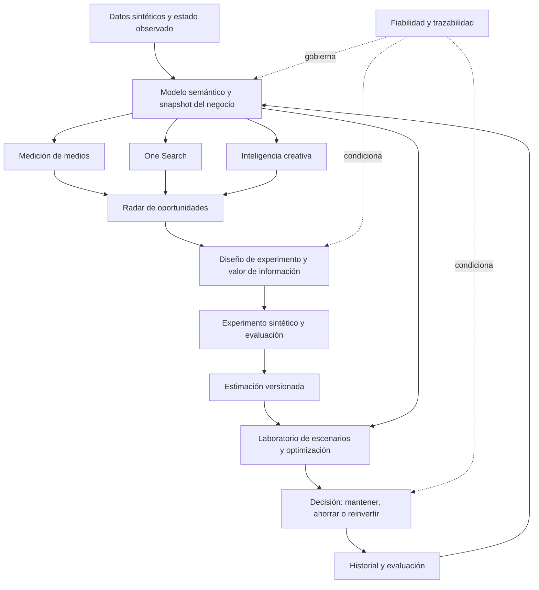

# MARGIA — PRD
## Product Requirements Document · Requisitos de producto

| Metadato | Valor |
|---|---|
| Producto | MARGIA · Marketing Decision Intelligence |
| Lema | Cada decisión tiene un valor |
| Versión | 1.0 · 25/11/2026 |
| Estado | Propuesta de requisitos para la POC avanzada; pendiente de validación e implementación |
| Entrega objetivo | v0.1.0-demo, seis jornadas de desarrollo asistido por Codex |
| Idioma | Español (España) |
| Repositorio | https://github.com/nacho-coding/margia.git |
| Ubicación | `/PRD.md` |
| Documento complementario | [`RFC.md`](RFC.md) |

> **Propósito:** establecer qué producto se construye, para quién, qué problema resuelve, cómo se demuestra el valor y qué condiciones permiten aceptar la entrega. No acredita resultados comerciales reales ni una aplicación ya implementada.

## 1. Contexto y documentación vinculante

MARGIA nace como una propuesta de producto de inteligencia de decisiones de marketing, inspirada en la integración semántica y los flujos de decisión de plataformas empresariales. Responde a tres necesidades: medición de la contribución de medios, One Search (SEO y SEM) e inteligencia creativa basada en datos. La preocupación fundamental es que el valor incremental de la solución supere el coste de desarrollarla, mantenerla y utilizarla, especialmente cuando los datos son incompletos o inestables.

El producto es una POC autónoma con un universo de negocio sintético, una interfaz profesional y cálculos realmente ejecutados. No se presenta como una solución oficial de una consultora, una implantación de cliente, ni una reproducción de Palantir.

### 1.1. Contrato documental

Este PRD sintetiza y organiza los requisitos existentes; no sustituye los documentos detallados ni amplía automáticamente el alcance. Se ha elaborado tomando como referencia la documentación inicial de `main`, commit `ccf1a645e152d05ae649d285477ebfb5ee715886` (los ocho archivos de raíz permanecían sin cambios al consultarlos el 25/11/2026).

| Documento | Autoridad dentro de su ámbito |
|---|---|
| [`AGENTS.md`](AGENTS.md) | Reglas de trabajo, privacidad, Git, uso de skills y prohibición de agentes |
| [`ESPECIFICACION_MARGIA.md`](ESPECIFICACION_MARGIA.md) | Alcance funcional y recorridos detallados |
| [`DESIGN.md`](DESIGN.md) | Identidad visual, UX y criterios de revisión visual |
| [`DATOS_SINTETICOS.md`](DATOS_SINTETICOS.md) | Universo, generación, contratos y granularidad |
| [`MODELOS_MATEMATICOS.md`](MODELOS_MATEMATICOS.md) | Fórmulas, inferencia, incertidumbre y condiciones de abstención |
| [`PLAN_DESARROLLO.md`](PLAN_DESARROLLO.md) | Orden de implementación, planificación y pruebas A01–A14 |
| [`RFC.md`](RFC.md) | Propuesta de arquitectura y decisiones técnicas para satisfacer el PRD |

En conflicto, prevalecen veracidad, seguridad, restricciones explícitas del usuario y contratos especializados. Codex documentará la discrepancia y su resolución en `documentacion/decisiones.md`; no asumirá que este PRD autoriza trabajo adicional.

## 2. Resumen ejecutivo

**Problema:** los equipos de marketing disponen de métricas, herramientas y modelos dispersos. La atribución puede confundir captura con generación de demanda, el SEO y el SEM pueden competir por el mismo tráfico, y la creatividad se optimiza a menudo a partir de métricas no causales. Los datos cambian, y no todas las oportunidades justifican el coste de analizarlas o experimentar.

**Propuesta:** una capa de inteligencia de decisiones que conecte medición, búsqueda y creatividad sobre una misma representación del negocio, permita simular intervenciones, estime su impacto económico y su riesgo, recomiende la siguiente acción y aprenda de la evidencia experimental.

**Promesa de producto:** medir, comprender, simular, decidir y aprender, sin perder trazabilidad ni confundir estimaciones con hechos observados.

**Diferenciación que debe demostrar la POC:** no es el número de modelos o pantallas, sino el recorrido completo de una decisión que atraviesa los tres ámbitos y termina en una recomendación económicamente defendible, incluyendo la posibilidad de mantener la estrategia actual.

**Unidad de valor:** euros de contribución incremental neta estimada respecto a una alternativa comparable, condicionada a evidencia, riesgo, horizonte y costes. No se promete un ROI positivo.

## 3. Objetivos y no objetivos

### 3.1. Objetivos

| ID | Objetivo | Evidencia de cumplimiento en la demo |
|---|---|---|
| O1 | Unificar las tres líneas estratégicas | Una oportunidad de marca conecta medición, One Search, experimentación, creatividad y asignación presupuestaria. |
| O2 | Convertir análisis en decisiones | El usuario puede comparar mantener, ahorrar y reinvertir; registra una decisión con motivo y evidencia. |
| O3 | Medir valor neto, no solo rendimiento atribuido | Todos los escenarios incluyen ingresos, margen, gasto, costes relevantes y delta económico reconciliado. |
| O4 | Trabajar con incertidumbre y datos imperfectos | Se muestran intervalos o límites explícitos; un incidente impide aprobar recomendaciones afectadas. |
| O5 | Aprender de la evidencia | Un experimento sintético genera observaciones y, si supera controles, una nueva estimación versionada. |
| O6 | Demostrar calidad de producto | UI premium, rápida, coherente, usable y probada en navegador; controles funcionales. |
| O7 | Mantener coste y complejidad acotados | Ejecutable localmente con CPU, datos regenerables, sin servicios externos obligatorios de pago. |

### 3.2. Fuera de alcance de v0.1.0-demo

- Empresas múltiples, onboarding de clientes, multitenancy, roles de seguridad corporativos y despliegue público.
- IoT, edge, logística, inventario, energía, personal, operaciones físicas y finanzas corporativas.
- Integración o activación real con plataformas publicitarias, CRM, CDP o datos reales de terceros.
- IA generativa local, Ollama, entrenamiento de LLM, GPU obligatoria, llamadas externas de IA necesarias para operar o agentes/subagentes de desarrollo.
- Generación autónoma en producción de imágenes o vídeos; chatbot, 3D y arquitectura distribuida innecesaria.
- Atribución individual causal, MMM de nivel productivo, predicción garantizada de creatividad o validación de resultados comerciales reales.

Los modelos estadísticos y el ML ligero en CPU son parte del alcance. Se pueden usar skills fiables de diseño, UX/UI, imágenes y pruebas durante el desarrollo, sin delegar a agentes.

## 4. Usuarios y trabajos a resolver

La demo contiene perspectivas de usuario, no un sistema de autenticación ni permisos de producción.

| Perspectiva | Necesidad | Decisión o resultado |
|---|---|---|
| Dirección de marketing / CMO | Saber dónde se pierde eficiencia y qué inversión genera valor neto | Aprobar, rechazar o pedir evidencia antes de reasignar presupuesto. |
| Analista de medición / Data Scientist | Contrastar atribución, modelos de respuesta e incrementalidad | Revisar ajuste, incertidumbre, extrapolación y versiones de evidencia. |
| Responsable de Search | Gestionar paid y organic search conjuntamente | Elegir qué grupos/mercados probar y qué recortes son demasiado arriesgados. |
| Responsable creativo | Diseñar mejores hipótesis y aprender de pruebas anteriores | Comparar variantes, preparar brief, experimentar y elegir una alternativa. |

El comprador económico potencial sería dirección de marketing o dirección comercial, acompañado de responsables de medición y tecnología. Es una hipótesis de posicionamiento, no una validación comercial.

## 5. Concepto de producto: un único gemelo comercial

MARGIA representa el estado y evolución de inversión, demanda, captura de tráfico y resultados económicos de AUREL Retail, un comercio ficticio omnicanal de moda, hogar y belleza. Todas las vistas se conectan al mismo contexto de marca, mercado, periodo, campaña, canal, snapshot y evidencia disponible.

No son varios gemelos ni un simple menú de modelos. La venta propia única es la referencia económica. Las conversiones atribuidas de distintas plataformas son observaciones que pueden solaparse. Los estados de una simulación no sobrescriben el histórico. La actualización de un modelo no modifica retrospectivamente ejecuciones guardadas.

### 5.1. Universo demostrativo

Se aplicará el contrato `DATOS_SINTETICOS.md`. Magnitudes de referencia, no requisitos de volumen rígidos:

| Variable | Objetivo |
|---|---|
| Empresa | AUREL Retail, una única organización ficticia |
| Mercados | 24 mercados sintéticos de España |
| Histórico | 730 días; aproximadamente 104 semanas de modelado |
| Inversión anual | 4,8 M€ objetivo; coste de CRM explícito |
| Canales | SEM de marca, SEM genérico, Meta, TikTok, YouTube, display, TV y CRM; SEO/directo no pagados |
| Campañas / grupos de búsqueda | 120 / 50 |
| Creatividad / cohortes / experimentos | 80 registros creativos objetivo, 8 cohortes agregadas, 12 experimentos históricos |
| Activos visuales | Al menos 12 originales locales, con procedencia y licencia documentadas |
| Registros | 150–300 mil orientativos; perfil ligero si se necesita; no cruzar todos los granos artificialmente |
| Horizonte por defecto | 28 días para escenarios; fecha de corte fija y visible |

Datos sintéticos reproducibles, sin información personal, activos o marcas de clientes reales. Las asignaciones y resultados futuros del mundo sintético se mantienen fuera de los datos disponibles al estimador hasta su fecha de observación simulada.

## 6. Requisitos funcionales

**P0:** núcleo de aceptación de la demo. **P1:** mejora posterior al recorrido estable. **P2:** evolución comercial, no comprometida en seis jornadas. La prioridad no autoriza afirmar que una función incompleta está terminada. Los detalles de cálculo se encuentran en `MODELOS_MATEMATICOS.md`.

### RF-01 · Centro de decisiones y radar — P0 — `/`

**Historia:** como director de marketing, quiero identificar oportunidades y comprender su impacto económico sin investigar manualmente cada panel.

- Mostrar KPIs de inversión, ventas netas, pedidos únicos, margen bruto, contribución después de marketing y evolución temporal, con periodo, unidad y definición.
- Priorizar oportunidades de reducción de marca, reasignación y creatividad a partir de estimaciones calculadas, riesgo, coste y evidencia. No sumar oportunidades solapadas.
- Navegar a una hipótesis vinculada a las entidades y el snapshot de origen. Mostrar decisiones recientes.

**Aceptación:** cambiar el contexto actualiza las métricas donde sea válido; una oportunidad abre una hipótesis real y reproducible; importes conciliados con API y fuente económica. No hay cifras hardcodeadas de negocio.

### RF-02 · Medición de medios — P0 — `/medicion`

**Historia:** como analista, quiero separar rendimiento atribuido de contribución incremental estimada y entender la fiabilidad de cada estimación.

- MMM simplificado en CPU, con adstock, saturación, controles, regularización, validación temporal y comparación con referencia naive.
- Visualizar contribuciones, baseline, residual, curvas de respuesta y retorno marginal en el soporte observado; explicar las unidades, horizonte y limitaciones.
- Tabla de métricas de gasto, exposición, conversión e ingresos atribuidos, ROAS atribuido y estimaciones modeladas cuando sean defendibles. Mostrar n/d cuando no exista denominador o identificación suficiente.
- Distinguir generación de demanda de captura; no contabilizar dos veces SEM de marca con One Search. No presentar un coeficiente predictivo como efecto causal.

**Aceptación:** modelo ajustado y consultable, holdout temporal y diagnóstico reales; descomposición reconciliada; filtros no fabrican modelos a granularidades incompatibles; curvas navegables y escenario accesible.

### RF-03 · One Search — P0 — `/one-search`

**Historia:** como responsable de búsqueda, quiero estimar qué inversión de marca puede reducirse sin destruir margen.

- Analizar SEO y SEM por grupo de consultas y mercado: marca pura, marca + producto, genéricas y contexto competitivo.
- Consultar clics, impresiones, posición orgánica, CPC, inversión, atribución cuando disponible, elegibilidad y evidencia de sustitución.
- Simular reducción entre 0 % y 100 % como hipótesis; limitar recomendaciones al soporte de la evidencia y grupos elegibles.
- Calcular tráfico/pedidos afectados según la unidad modelada, recuperación, pérdida de pedidos y margen, ahorro, costes, punto de equilibrio e incertidumbre. No asumir recuperación total por SEO.
- Preparar un experimento asociado. Explicar cuándo mantener inversión.

**Aceptación:** controles modifican el resultado en backend; caso favorable y caso desfavorable comprobables; sin joins individuales inexistentes entre búsquedas y ventas; no se aprueban extrapolaciones no sustentadas como recomendaciones fiables.

### RF-04 · Laboratorio de experimentos — P0 — `/experimentos`

**Historia:** como analista, quiero convertir una hipótesis en un experimento y evaluar la evidencia sin confundir simulación con prueba real.

- Diseñar experimento geográfico: hipótesis, tratamiento, mercados, KPI primario, pre/postperiodo, coste, guardrails, semilla y MDE aproximado.
- Emparejar y aleatorizar mercados; mostrar equilibrio, limitaciones de potencia, riesgo de spillover y pruebas placebo.
- Ejecutar el tratamiento en el mundo sintético, persistir asignaciones y observaciones y estimar efecto e intervalo a nivel de unidad aleatorizada.
- Permitir conservar o actualizar evidencia compatible y suficiente, con nueva versión; conservar el histórico. No actualizar ante fallos de validez.
- Preparar y ejecutar una prueba A/B creativa sintética mediante flujo análogo, con denominadores correctos y tratamiento comparable.

**Aceptación:** asignación reproducible; experimento nulo o negativo posible; resultados no proceden de una cifra prefijada en interfaz; evaluación muestra límites y conserva trazabilidad.

### RF-05 · Valor de la información — P0 — integrado en experimentos

**Historia:** como responsable de presupuesto, quiero saber si merece la pena gastar recursos en reducir la incertidumbre.

- Comparar actuar, mantener y experimentar sobre el mismo horizonte y utilidad económica.
- Mostrar EVPI y, si el diseño de experimento lo permite, EVSI calculado con su modelo de observación; si no, mostrar EVPI exclusivamente como cota superior.
- Descontar coste de la prueba, impacto durante el tratamiento y, cuando se modele, coste de demora. Recomendar no experimentar si no hay valor neto esperado suficiente.

**Aceptación:** EVPI no negativo, EVSI no superior a EVPI salvo tolerancia numérica; caso cuyo coste supera la cota superior recomienda no experimentar. Nunca convertir una cota en una estimación de EVSI.

### RF-06 · Inteligencia creativa — P0 — `/creatividad`

**Historia:** como responsable creativo, quiero orientar el brief y priorizar pruebas mediante el aprendizaje histórico de la marca.

- Biblioteca visual con activos locales originales, etiquetas, filtros por canal, formato, objetivo, categoría, audiencia y periodo; detalle con métricas y procedencia.
- Antes de campaña: seleccionar un brief y comparar tres variantes mediante ML ligero entrenado con histórico; mostrar atributos, estimaciones, incertidumbre y reglas de marca. Generar recomendaciones/brief con reglas y plantillas basadas en datos.
- Después de campaña: comparar resultados observados sintéticos, contexto, limitaciones y pruebas aleatorias; registrar hipótesis aprendidas y, si procede, una versión nueva del estimador.
- Enviar una variante al escenario de reinversión; su efecto debe modificar la respuesta del canal asociado, sin añadir conversiones duplicadas.

**Aceptación:** activos locales no vacíos, tres variantes evaluadas por cálculo real, histórico consultable, prueba A/B reproducible; selección afecta al escenario integrado cuando hay evidencia suficiente. No afirmar generación multimodal en runtime ni causalidad de atributos correlacionados.

### RF-07 · Escenarios y optimización — P0 — `/escenarios`

**Historia:** como director de marketing, quiero evaluar futuros alternativos antes de ejecutar cambios de inversión.

- Crear, editar borrador, duplicar, ejecutar, comparar, guardar y archivar escenarios con snapshot y versión de modelos.
- Comparar baseline, A (ahorrar) y B (reinvertir); controles por canal, recorte de marca, creatividad, presupuesto, coste de experimento y cuota de plataforma. Mismo horizonte y supuestos comparables.
- Optimizar contribución esperada con restricciones, soporte observado y tolerancia al riesgo; permitir mantener estrategia o conservar ahorro. No obligar a consumir todo el presupuesto.
- Mostrar pedidos, ventas, margen, inversión, costes, delta, intervalos, probabilidad de pérdida condicionada al modelo y waterfall reconciliado. Exportar CSV y Markdown.
- Aprobar o rechazar una decisión simulada con motivo y evidencia; sin activar campañas externas.

**Aceptación:** el escenario con cero cambios y costes comunes tiene delta cero; ejecución idéntica es reproducible; no hay doble conteo; la solución cumple restricciones o informa inviabilidad; resultados y decisiones sobreviven reinicio.

### RF-08 · Fiabilidad y abstención — P0 — `/fiabilidad`

**Historia:** como director o analista, quiero saber si una recomendación es fiable y qué debo corregir cuando no lo sea.

- Inventario de fuentes, cobertura, frescura relativa a fecha de corte, duplicados, coherencia, tracking, drift y diagnósticos; estados válido, limitado y bloqueado por modelo o ámbito.
- Simular incidencia creando un snapshot alternativo (faltantes o ruptura de tracking) sin corromper la base sana.
- Bloquear en backend las aprobaciones afectadas, identificar alcance y requisito de recuperación; permitir consulta histórica y análisis no afectados.
- Restaurar contexto sano sin borrar el historial de decisiones.

**Aceptación:** la incidencia se detecta realmente por reglas, la API impide aprobar una recomendación bloqueada, la interfaz explica el motivo y la restauración devuelve el estado permitido.

### RF-09 · Contexto, historial y exportaciones — P0 — transversal

- Contexto global visible de snapshot, periodo y mercado; contratos de filtros por grano y alcance. Mantener contexto entre vistas y devolver al usuario a su hipótesis.
- Registrar transiciones de decisión, estimaciones, escenarios, ejecuciones y supuestos con identificadores, fechas, semillas y versiones.
- Disponer de estados carga, vacío, error, insuficiencia, éxito y cálculo real. No mostrar controles esenciales inertes.
- Reset explícito con confirmación; regeneración idempotente; persistencia entre reinicios normales. Exportaciones de resultados con supuestos, datos sintéticos y advertencias.

**Aceptación:** el mismo contexto produce KPIs consistentes entre vistas, las exportaciones coinciden con ejecución guardada y el reset reconstruye la realidad base definida.

### 6.1. Evolución no bloqueante

| Prioridad | Mejora |
|---|---|
| P1 | Editor/exportación del brief, fatiga creativa, cartera de experimentos ordenada por valor neto, grafo navegable de relaciones y modo oscuro completo si hay tiempo. |
| P2 | Conectores autorizados, autenticación/RBAC, despliegue empresarial, calibración sobre pilotos reales, creatividad multimodal opcional, MMM y atribución de mayor fidelidad, activación gobernada. |

P2 exige evaluación y autorización nuevas. No es una orden de implementación para Codex. La generación automática de contenido en ejecución permanece fuera de la demo.

## 7. Recorrido de demostración y criterios de éxito

Duración orientativa: 7–10 minutos. El demo debe ser utilizable sin conocimientos técnicos y repetible desde un estado conocido.

| Paso | Interacción del usuario | Resultado que se comprueba |
|---|---|---|
| 1 | Entra al centro de decisiones | Radar y KPIs de un mismo negocio. |
| 2 | Abre oportunidad SEM de marca desde medición | ROAS atribuido alto no prueba contribución incremental alta. |
| 3 | Configura recorte del 50 % y modifica supuestos | Cambian pérdida, ahorro, margen, equilibrio y riesgo. |
| 4 | Diseña experimento y evalúa su valor | Se justifica si conviene experimentar; muestra coste y potencia aproximada. |
| 5 | Ejecuta experimento sintético y revisa resultado | Evidencia nueva, estimador actualizado cuando sea válido. |
| 6 | Compara tres variantes creativas y elige una | Hipótesis y efectos esperados conectados a un canal. |
| 7 | Compara mantener, ahorrar y reinvertir | Contribución neta, incertidumbre y optimización factible. |
| 8 | Aprueba o rechaza y exporta | Decisión persistida y explicable. |
| 9 | Activa incidencia de tracking | Abstención verificable, no una alerta decorativa; restauración del contexto. |

**Recorrido alternativo obligatorio:** mercado con menor cobertura orgánica, resultado experimental insuficiente o hipótesis de pérdida de margen que supera el ahorro → mantener SEM o no actuar. El producto no se diseña para forzar recomendaciones favorables.

### 7.1. Ejemplo económico de aceptación (fixture, no forecast)

Mismo horizonte mensual, comparación simplificada de contratación de la solución frente a no contratarla; se imputa la cuota completa a este caso, sin otros costes de prueba o producción.

| Variable | Hipótesis |
|---|---:|
| SEM de marca base | 60.000 € |
| Reducción | 50 % |
| Ahorro bruto | 30.000 € |
| Pedidos afectados estimados | 3.000 |
| Recuperación | 92 % |
| Pedidos recuperados / perdidos | 2.760 / 240 |
| Margen unitario / margen perdido | 50 € / 12.000 € |
| Cuota imputada de plataforma | 6.000 € |
| **Beneficio neto frente a referencia** | **12.000 €** |

Con recuperación del 70 %, el resultado es −21.000 €. El punto de equilibrio en este ejemplo es 84 %. Con cuota común a ambas estrategias, se cancela en la comparación marginal y cambia el punto de equilibrio. La fixture valida aritmética; no determina el resultado de la empresa ficticia ni demuestra ahorros reales.

## 8. KPIs de producto y contrato de medición

| KPI | Definición / criterio |
|---|---|
| Contribución neta | Margen bruto − inversión − costes creativos − experimentos − plataforma − otros costes relevantes. |
| Delta de contribución | Diferencia entre escenario y base bajo horizonte y reglas de costes comparables. |
| ROAS atribuido | Ingresos atribuidos / gasto; no causal ni equivalente a beneficio. |
| iROAS | Cambio incremental estimado de ingresos / cambio de inversión, con signo, método y denominador definidos. |
| Ahorro bruto | Inversión base − inversión alternativa; no sumar nuevamente al delta de contribución. |
| Punto de equilibrio | Hipótesis mínima de recuperación/efecto para delta ≥ 0 según costes. |
| Probabilidad de pérdida | Fracción de réplicas con delta negativo, condicionada al modelo y supuestos. |
| Valor neto de experimentar | Valor esperado de información menos costes pertinentes. |
| Fiabilidad | Estado explicable según reglas de datos y modelos, no una confianza subjetiva inventada. |

Se distinguirán cuatro tipos de evidencia: observación sintética, atribución de plataforma sintética, estimación/modelo, resultado de experimento sintético. La hipótesis manual se marca de forma separada. Números con precisión acorde a su incertidumbre; `n/d` ante no identificabilidad o denominador nulo.

### 8.1. Indicadores de éxito de la POC

- El recorrido principal y el alternativo superan pruebas de extremo a extremo, incluidas persistencia y abstención.
- La misma entrada, snapshot, versiones y semilla reproducen el resultado dentro de tolerancias documentadas.
- Las métricas económicas se concilian; no hay doble conteo de demanda, gasto ni conversiones.
- El producto se puede arrancar desde un entorno limpio y utilizar en modo local de producción, con todos los controles esenciales operativos.
- Revisión visual real de pantallas clave y estados; documentación de pruebas y defectos pendientes.

Los indicadores de adopción, ahorro real, precisión sobre clientes reales, amortización y conversión comercial solo se medirían en un piloto posterior autorizado. No se asignan objetivos numéricos de ROI comercial a partir de la simulación.

## 9. Requisitos no funcionales

| ID | Requisito | Criterio |
|---|---|---|
| RNF-01 | Experiencia premium | Cumplir DESIGN.md; shell coherente, verde institucional y oro discreto, tipografía legible, tablas y gráficos profesionales; sin plantillas genéricas ni 3D ornamental. |
| RNF-02 | Accesibilidad | Contraste objetivo WCAG AA, teclado, foco, texto alternativo, estados no codificados solo con color, reduced-motion. |
| RNF-03 | Rendimiento | Objetivo de navegación caliente <2 s, simulación pequeña <5 s y generación/entrenamiento <5 min cuando el equipo lo permita; medir y documentar. |
| RNF-04 | Ejecución local | Docker Compose en Windows, perfil CPU, persistencia, modo producción local; sin GPU ni IA local. |
| RNF-05 | Robustez | Validar inputs y rangos, tratamiento de errores y datos ausentes, estados explícitos de cálculo e insuficiencia. |
| RNF-06 | Privacidad y seguridad | Sin datos reales, secretos ni credenciales en Git; servicios locales, sin activación externa; no apto para exposición pública. |
| RNF-07 | Trazabilidad | Snapshot, modelo, semilla, parámetros, supuestos y decisión versionados; exportación reproducible. |
| RNF-08 | Diseño responsivo | Referencia 1440×900 / 1920×1080, comprobación 1280×720 y lectura tablet/móvil; revisión visual, no solo build. |
| RNF-09 | Idioma | Interfaz, ayuda, errores, documentación y guion en español; identificadores técnicos convencionales permitidos. |

## 10. Plan de entrega y alcance mínimo

Se aplica `PLAN_DESARROLLO.md`. Las seis jornadas son objetivo de planificación (aprox. 40–48 h), no compromiso de que todo el alcance pueda completarse.

| Jornada | Hito | Puerta de salida |
|---|---|---|
| 1 | Fundaciones, datos, shell y centro | Arranque limpio, seed, persistencia y KPIs reales. |
| 2 | Medición y primera oportunidad | MMM entrenado, diagnóstico, curvas y motor económico. |
| 3 | One Search, geoexperimento y valor de información | Recorrido oportunidad → hipótesis → evidencia. |
| 4 | Creatividad y reinversión | Selección creativa conecta a cálculo de escenario y optimización. |
| 5 | Integración y fiabilidad | Historial, decisión, exportación, incidencia y restauración. |
| 6 | Congelación, QA y presentación | Pruebas, capturas, correcciones, guion y entrega candidata. |

Si falta tiempo, reducir amplitud de datos, filtros, animaciones, P1 y complejidad de modelos antes que eliminar el cálculo común, persistencia, abstención o QA. Si algún P0 queda pendiente, informar y no declararlo finalizado. No construir un segundo producto para completar el primero.

## 11. Matriz de trazabilidad y aceptación

IDs A01–A14 corresponden a `PLAN_DESARROLLO.md`.

| Requisito | Pruebas | Evidencia mínima |
|---|---|---|
| RF-01 | A02, A11 | KPI desde API, reconciliación y radar navegable. |
| RF-02 | A03 | Ajuste, holdout, descomposición y curvas con límites. |
| RF-03 | A04 | Fixture aritmética, recorte dinámico y alternativa negativa. |
| RF-04 | A05 | Aleatorización, inferencia, versiones y resultado no favorable. |
| RF-05 | A08 | EVPI/EVSI o cota explícita; coste superior al valor. |
| RF-06 | A06 | Biblioteca, pre/post, A/B, selección y efecto en escenario. |
| RF-07 | A07, A10 | Comparador, factibilidad, delta e historial. |
| RF-08 | A09 | Bloqueo efectivo en API, explicación y restauración. |
| RF-09 | A01, A02, A10, A11 | Arranque, seed, reinicio, contexto, exportación y controles. |
| RNF-01/02/08/09 | A11, A12 | Capturas reales y revisión de uso y accesibilidad básica. |
| RNF-03/04/05 | A01, A07, A11 | Mediciones, validación y recuperación de errores. |
| RNF-06/07 | A10, A13, A14 | Auditoría, versiones, repositorio y documentación. |

**Definition of Done:** implementación integrada, pruebas ejecutadas y registradas con resultado real, revisión visual de pantallas modificadas, persistencia comprobada cuando proceda, ausencia de defectos críticos conocidos para el recorrido, documentación actualizada y commit/push verificados. No usar una maqueta como sustituto de evidencia.

## 12. Riesgos y decisiones abiertas de producto

| Riesgo | Mitigación |
|---|---|
| Exceso de alcance para seis días | Priorizar un flujo vertical, simplificar y congelar el día 6. |
| Datos sintéticos demasiado perfectos | Estacionalidad, confusión, fallos, heterogeneidad, experimentos nulos y negativos; evaluación con verdad sintética aislada. |
| Confundir atribución con causalidad | Etiquetas, validación, experimentación y abstención; no sumar efectos solapados. |
| Coste supera valor | Incorporar costes, umbrales y valor de información; permitir no actuar. |
| Interfaz atractiva pero no funcional | Backend como fuente de cálculos, pruebas de extremo a extremo y capturas reales. |
| Marca ficticia o repositorio público | Mantener activos originales y sin información privada; valorar repositorio privado antes de publicar detalles sensibles. |
| Dependencia tecnológica no prevista | CPU, sin servicios externos obligatorios y recursos locales; fijar versiones. |

Decisiones abiertas: disponibilidad de recursos gráficos con licencia, granularidad final del perfil ligero, cobertura real de modelos y umbrales de fiabilidad tras pruebas, estrategia comercial y validación en un cliente. El nombre AUREL Retail y la identidad MARGIA son denominaciones provisionales; no se ha comprobado disponibilidad marcaria. No bloquear la POC por cuestiones de comercialización futura.

## 13. Recomendación de inicio para Codex

Leer el PRD junto al RFC y documentos especializados; convertir cada RF/RNF en tareas verificables del plan existente. Construir primero una rebanada vertical con datos y centro de decisiones. A continuación conectar medición, búsqueda, experimento y escenarios; incorporar creatividad al mismo cálculo. Mantener `documentacion/avances.md` y `documentacion/validacion.md` desde el primer hito. No usar agentes ni subagentes, ni modelos generativos locales. No ampliar el alcance para satisfacer indicadores hipotéticos de un producto futuro.
