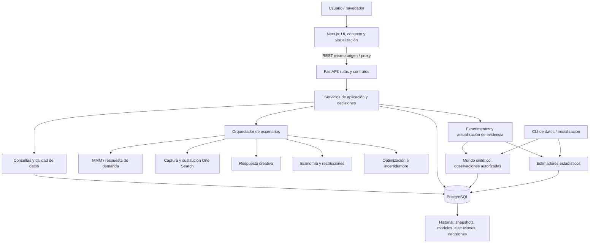
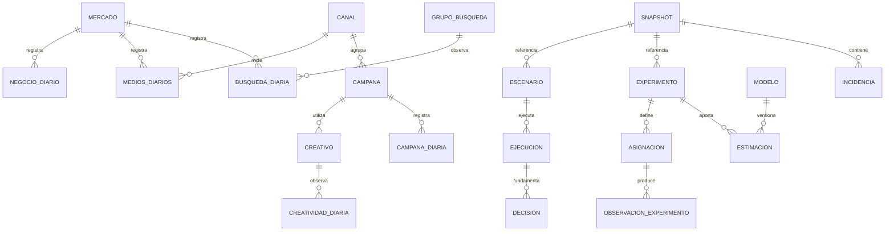

# MARGIA — RFC-001
## Request for Comments · Arquitectura técnica y diseño de implementación

| Metadato | Valor |
|---|---|
| Producto | MARGIA · Marketing Decision Intelligence |
| Versión | 1.0 · 25/11/2026 |
| Estado | Propuesto; pendiente de revisión técnica y comprobación en el entorno de desarrollo |
| Objetivo | v0.1.0-demo, POC funcional de seis jornadas |
| Repositorio | https://github.com/nacho-coding/margia.git |
| Ubicación | `/RFC.md` |
| Requisitos | [`PRD.md`](PRD.md) |

> Este RFC propone cómo implementar MARGIA. Es una decisión de arquitectura revisable, no un informe de software existente. Las elecciones de librerías, interfaces, umbrales y recursos se confirmarán mediante pruebas. No afirma que se haya ejecutado una compilación, entrenamiento o benchmark.

## 1. Resumen y alcance técnico

Construir un monolito modular de dominio y simulación, una API REST y una interfaz web profesional con persistencia PostgreSQL. Todos los módulos comparten un modelo de negocio temporal, referencias de evidencia, snapshots inmutables y un único orquestador económico. El entorno es local, reproducible, ejecutable en Windows con Docker Desktop en modo de producción, íntegramente CPU y con datos sintéticos.

No construir un sistema distribuido, CDP, data lake, motor de agentes, base de datos de grafos, plataforma de activación de medios ni servicios de IA generativa local. No exigir GPU, conectores ni claves de APIs de pago. Las skills de diseño, UX/UI, imágenes y pruebas podrán utilizarse durante el desarrollo sin agentes, subagentes ni delegación. El software debe funcionar incluso si no se dispone de herramientas de generación de imágenes.

### 1.1. Fuentes y precedencia

Referencia: ocho archivos iniciales del repositorio `main`, commit `ccf1a645e152d05ae649d285477ebfb5ee715886`; sus contenidos permanecían sin cambios en la consulta del 25/11/2026.

- [`PRD.md`](PRD.md) y [`ESPECIFICACION_MARGIA.md`](ESPECIFICACION_MARGIA.md): requisitos funcionales y experiencia de producto.
- [`DATOS_SINTETICOS.md`](DATOS_SINTETICOS.md): entidades, granos, generador y volumen orientativo.
- [`MODELOS_MATEMATICOS.md`](MODELOS_MATEMATICOS.md): contrato de cálculo e inferencia.
- [`DESIGN.md`](DESIGN.md): diseño y revisión visual.
- [`PLAN_DESARROLLO.md`](PLAN_DESARROLLO.md): fases y aceptación A01–A14.
- [`AGENTS.md`](AGENTS.md): normas de ejecución, seguridad y Git.

Las decisiones de este RFC concretan, no sustituyen, esos documentos. Cuando se detecten incompatibilidades, respetar seguridad y veracidad, mantener el contrato matemático y funcional especializado y registrar cualquier ajuste en `documentacion/decisiones.md`. Las rutas y nombres de campos propuestos se pueden adaptar manteniendo su semántica y pruebas. No ampliar el alcance sin necesidad.

## 2. Decisiones de arquitectura (ADR resumidos)

| ADR | Decisión propuesta | Motivo |
|---|---|---|
| ADR-01 | Backend monolito modular con Python/FastAPI | Menor coste de integración y despliegue que microservicios; reutilización de funciones de cálculo. |
| ADR-02 | PostgreSQL + SQLAlchemy + Alembic | Integridad referencial, transacciones, migraciones, versiones y resultados persistidos. |
| ADR-03 | Next.js + React + TypeScript + Tailwind + ECharts | UI densa y accesible, gráficas profesionales, componentes reutilizables y tipado. |
| ADR-04 | Ontología relacional y semántica compartida | Entidades, relaciones, eventos y acciones sin necesidad de una plataforma de grafos propia. |
| ADR-05 | Orquestador de escenarios único | Evitar doble conteo, divergencias de fórmulas y simulaciones independientes. |
| ADR-06 | Mundo sintético separado del estimador | Impedir fuga de parámetros verdaderos y resultados futuros al entrenamiento. |
| ADR-07 | Modelos ligeros, cálculo batch y caché | CPU convencional, sin LLM locales, entrenamiento pesado ni dependencia obligatoria de pago. |
| ADR-08 | Evidencia y ejecuciones versionadas | Trazabilidad, reproducibilidad y comparaciones justas; actualizar no implica reescribir historia. |
| ADR-09 | Abstención en backend | Un dato o modelo bloqueado no puede autorizar una decisión dependiente aunque se manipule el frontend. |
| ADR-10 | Docker Compose y un solo origen web local | Arranque reproducible, aislamiento básico de servicios y menor complejidad operativa. |
| ADR-11 | Ejecución secuencial mediante Codex | Sin agentes; commits pequeños, revisión visual y pruebas por hito. |
| ADR-12 | Activos visuales originales locales | Producto pulido sin generación multimedia en runtime, llamadas remotas ni licencias desconocidas. |

**Alternativas rechazadas para v0.1.0:** microservicios por módulo, Kubernetes, Redis/Celery por defecto, Neo4j, motores de workflow empresariales, LLM local, IA multimodal en runtime, agentes autónomos, 3D, almacén de datos independiente y conectores de plataformas reales. Estas alternativas no están prohibidas para toda evolución futura; no están justificadas para seis jornadas de POC.

## 3. Arquitectura lógica



En el diagrama, las flechas indican dependencias lógicas, no microservicios. El mundo sintético y el estimador son paquetes aislados dentro del backend; el estimador recibe exclusivamente observaciones autorizadas, no parámetros verdaderos ni futuros. El optimizador evalúa el mismo orquestador que usa el simulador; no se deben crear dependencias recursivas entre ambos.

### 3.1. Capas y límites de responsabilidad

| Capa | Responsabilidad | Prohibiciones |
|---|---|---|
| Web | Navegación, componentes, accesibilidad, estados, filtros, gráficos y formularios | No recalcular márgenes, efectos o simulaciones con fórmulas divergentes en JavaScript. |
| API | Validar DTO, contexto, estados, límites y errores; serializar resultados | No alojar modelos complejos dentro de handlers HTTP. |
| Aplicación | Coordinar consultas, escenarios, experimentos, persistencia y transiciones | No mezclar cálculos con rendering; no aceptar aprobaciones sin revalidar. |
| Dominio | Reglas económicas, unidades, restricciones, evidencia y estados | No depender de HTTP, navegador o base de datos. |
| Modelos | Ajuste, predicción, diagnóstico, experimentación, optimización | No leer parámetros verdaderos del generador ni observaciones posteriores al corte. |
| Mundo sintético | Generar histórico y nuevas observaciones experimentales | No ser utilizado como sustituto de estimaciones reales del modelo. |
| Persistencia | Repositorios, agregaciones, transacciones, snapshots, versiones | No modificar resultados históricos tras reentrenar. |

## 4. Estructura de repositorio propuesta

```text
margia/
├── AGENTS.md
├── README.md
├── PRD.md
├── RFC.md
├── ESPECIFICACION_MARGIA.md
├── DESIGN.md
├── DATOS_SINTETICOS.md
├── MODELOS_MATEMATICOS.md
├── PLAN_DESARROLLO.md
├── PROMPT_CODEX.md
├── docker-compose.yml
├── .env.example
├── .gitignore
├── frontend/
│   ├── src/app/                 # rutas y shell persistente
│   ├── src/componentes/          # UI, tablas, gráficos, evidencia
│   ├── src/features/             # centro, medición, búsqueda, creatividad...
│   ├── src/servicios/            # API tipada y consultas
│   ├── src/estilos/              # tokens DESIGN.md
│   ├── public/assets/           # logo, iconos y creatividades locales
│   └── pruebas/                 # Playwright y pruebas frontend
├── backend/
│   ├── app/api/                 # routers, DTO, errores
│   ├── app/aplicacion/          # coordinación de casos de uso
│   ├── app/dominio/             # economía, entidades, estados, invariantes
│   ├── app/datos/               # generador, calidad, agregaciones
│   ├── app/modelos/             # MMM, Search, creatividad, experimentación
│   ├── app/escenarios/          # evaluación, incertidumbre, optimización
│   ├── app/persistencia/        # ORM, repositorios, transacciones
│   ├── alembic/                 # migraciones
│   └── tests/                   # unitarias, integración, propiedades
├── scripts/                    # iniciar.ps1, detener.ps1, comprobar.ps1, reset_demo.ps1
└── documentacion/
    ├── avances.md
    ├── arquitectura.md
    ├── decisiones.md
    ├── licencias.md
    ├── guion_demo.md
    └── validacion.md
```

La estructura es orientativa. Se permite reorganizar módulos si se mantienen las dependencias y contratos. No crear capas abstractas sin uso real. `README.md` describirá comandos probados; `AGENTS.md` será el punto de entrada de Codex.

## 5. Pila técnica y entorno

| Componente | Tecnología | Restricción |
|---|---|---|
| Web | Next.js, React, TypeScript | Versiones estables y compatibles fijadas; build y servidor de producción. |
| UI | Tailwind, componentes accesibles propios | Tokens de DESIGN.md; evitar librerías de UI redundantes. |
| Visualización | Apache ECharts | Carga selectiva, series agregadas y tooltips con unidades. |
| API | Python, FastAPI, Pydantic | OpenAPI y validación estricta; contratos tipados. |
| Persistencia | PostgreSQL, SQLAlchemy, Alembic | Esquema versionado, índices, transacciones y volúmenes. |
| Cálculo | NumPy, SciPy, scikit-learn, statsmodels | CPU; operaciones vectorizadas, pocas dependencias. |
| Datos tabulares | Polars o pandas | Elegir uno como principal para reducir conversiones; el otro solo cuando sea necesario. |
| Pruebas | pytest, Playwright; lint y typecheck | E2E contra aplicación real; fixtures reproducibles. |
| Infraestructura | Docker Compose, Git, PowerShell | Windows/Docker Desktop; bind local; sin servicios externos obligatorios. |

No fijar versiones exactas sin comprobar compatibilidad en la máquina objetivo. Usar lockfiles y versiones explícitas de imágenes de contenedor. Propuesta inicial de presupuesto: hasta 8 GB de RAM para Docker si está disponible; limitar BLAS (`OMP_NUM_THREADS`, `OPENBLAS_NUM_THREADS`, `MKL_NUM_THREADS`) a 2 y evitar procesos de entrenamiento concurrentes. Son parámetros de partida, no mediciones del equipo del usuario.

## 6. Modelo semántico y de persistencia

### 6.1. Entidades y relaciones

El contexto único de la aplicación representa AUREL Retail; no existe selector de empresas ni tenant genérico. La ontología se implementa mediante PK/FK, contratos de métricas, relaciones de aplicación y transiciones de estado. No requiere base de datos de grafos.



Diagrama lógico abreviado; no representa todas las FK. La relación creativo/campaña es compatible con el grano de las tablas de exposición; si se reutiliza un activo en varias campañas, representar su relación de uso sin duplicar el gasto. Mantener el contrato `DATOS_SINTETICOS.md` como detalle canónico.

### 6.2. Granos, claves y unidades

| Entidad | Grano / integridad |
|---|---|
| `negocio_diario` | Snapshot × fecha × mercado; pedidos únicos, ventas netas, coste, margen y covariables. Referencia económica. |
| `medios_diarios` | Snapshot × fecha × mercado × canal; gasto y métricas atribuidas por fuente y ventana. |
| `campana_diaria` | Snapshot × fecha × mercado × campaña, subconjunto reconciliable del gasto del canal. |
| `busqueda_diaria` | Snapshot × fecha × mercado × grupo × fuente SEO/SEM; posición, impresiones, clics y gasto cuando correspondan. |
| `creatividad_diaria` | Snapshot × fecha × mercado × creativo × campaña, métricas y contexto de exposición; añadir cohorte solo si se define como grano. |
| `asignacion` | Experimento × unidad aleatorizada; brazo, par y probabilidad de asignación. |
| `observacion_experimento` | Experimento × unidad × periodo; KPI propio, coste y guardrails. |
| `estimacion`, `modelo` | Versión inmutable, objetivo, ámbito, corte, unidad, supuestos, evidencia y diagnóstico. |
| `escenario`, `ejecucion`, `decision` | Escenario y revisión, ejecución concreta, decisión auditable y referencias. |
| `incidencia` | Snapshot, fuente, regla, severidad, alcance y acción. |

Moneda EUR, importes sin IVA; almacenar céntimos enteros o `NUMERIC` con escala definida. Para modelos, convertir a float en cálculo y documentar tolerancias, redondear al presentar. Pedidos observados enteros; pedidos esperados pueden ser fraccionarios antes del redondeo visual. Tasas de cálculo en [0,1], porcentajes de UI en [0,100]. Fecha de negocio `DATE` en Europe/Madrid; timestamps de sistema `TIMESTAMPTZ`. No confundir reloj de ejecución con fecha sintética. Valores ausentes nulos y motivo; cero no equivale a ausencia.

Índices compuestos por snapshot/fecha/mercado/canal y por FK según consultas. Claves únicas de grano. Consultas agregadas en backend. No unir búsqueda y creatividad por un grano común ficticio ni sumar gasto padre e hijo; no agregar conversiones atribuidas como pedidos únicos. Las dimensiones de campaña y creativo son analíticas, no fuentes adicionales de gasto.

### 6.3. Snapshots, estimaciones y revisiones

- Snapshot base: manifiesto de generador, fecha de corte, semilla, versión de esquema/datos y checksum lógico. Inmutable tras publicarse.
- Snapshot alternativo: referencia al origen e incidencia. Implementar copia lógica/materializada o overlay reproducible; elegir la opción más simple que no corrompa la base. Mantener la misma identidad de entidades.
- Modelo: versión de código/configuración, conjunto de entrenamiento y cutoff, parámetros, features, preprocesamiento, diagnóstico, soporte y estado. Los artefactos pueden almacenarse como JSON/arrays o archivo local controlado referenciado por hash. No deserializar modelos de terceros no confiables.
- Experimento: protocolo congelado antes de ejecutar, asignaciones y observaciones persistidas; fechas de observación sintética explícitas. La evaluación posterior puede generar una versión nueva de evidencia, nunca cambiar la versión original.
- Escenario: borrador editable y revisiones de inputs. Cada ejecución captura snapshot, horizonte, versión y hash de parámetros, versiones de modelos/evidencias y semilla. Editar crea otra revisión; no altera resultados existentes.
- Decisión: referencia inmutable a ejecución, estado, motivo, fecha de sistema y evidencia. La aprobación no activa campañas externas ni cambia observaciones históricas.

La evidencia experimental nueva puede hacerse disponible mediante un nuevo contexto de evidencia o una nueva versión de snapshot con fecha simulada coherente; registrar la opción elegida. No permitir evaluar un modelo con conocimiento futuro respecto al corte declarado. Comparar escenarios solo con baselines, horizonte y versiones compatibles; si hay diferencias, indicar incompatibilidad y ofrecer nueva ejecución común.

## 7. Generación de datos y separación de la verdad sintética

### 7.1. Pipeline idempotente

1. Migrar esquema y comprobar versión de seed.
2. Generar calendario fijo, mercados, campañas, canales, creativos y consultas con IDs estables.
3. Generar inversión, estacionalidad, pulsos de medios, covariables exógenas, promoción y shocks.
4. Generar demanda, captura mutuamente excluyente paid/organic/direct/loss y efecto creativo en su canal; generar pedidos propios y contabilidad una sola vez.
5. Generar señales observadas de plataformas, atribuciones solapadas y vistas parciales; conservar procedencia y cobertura.
6. Generar experimentos históricos con controles, efectos positivos, nulos y negativos; reservar futuro.
7. Validar invariantes y reconciliación; publicar snapshot solo si validaciones mínimas pasan.
8. Ajustar modelos iniciales leyendo datos observados hasta el corte; guardar diagnóstico y resultados.

Semilla raíz 260725 y subsemillas mediante `numpy.random.SeedSequence`, según `DATOS_SINTETICOS.md`. Separar RNG por componente para que modificar creatividades no regenere arbitrariamente todos los datos. Ordenar registros antes de checksums; excluir timestamps de ejecución que no afectan el estado lógico. En un entorno y versión iguales, semilla y parámetros iguales producen datos iguales.

### 7.2. Protección contra leakage

El código generador del mundo puede utilizar los parámetros verdaderos, pero el paquete `modelos` no importa ni consulta esos parámetros. Las fixtures de evaluación de recuperación de efectos se almacenan separadas y se usan únicamente por tests/validación. No exponer verdad latente al frontend ordinario. El entrenamiento usa cortes temporales, escalado ajustado solo con train y controles disponibles antes de intervención. Las observaciones experimentales futuras se entregan al evaluador después de ejecutar el protocolo, no antes.

La recuperación aproximada de parámetros en un mundo sintético es una prueba interna de coherencia, no validez causal sobre empresas reales. El MMM puede no recuperar algunos parámetros por colinealidad y falta de identificación; la respuesta correcta es limitar su uso.

### 7.3. Volumen y CPU

730 × 24 × 8 = 140.160 filas si `medios_diarios` es completamente densa. 730 × 24 = 17.520 filas de negocio. Cruzar además 50 consultas y 80 activos en cada día/mercado superaría ampliamente el objetivo de 150–300 mil filas. Por tanto, materializar observaciones de campañas, búsqueda y creatividad solo en sus mercados, fechas y grupos activos; registrar cobertura y agregación. En perfil ligero reducir densidad o extensión de observaciones no críticas, no representar faltantes como ceros ni reducir unidades experimentales sin reevaluar potencia. Los volúmenes son objetivos flexibles; medir antes de ampliar.

## 8. Diseño del motor analítico

La especificación matemática canónica está en `MODELOS_MATEMATICOS.md`. Este apartado define interfaces, dependencias, criterios de uso y responsabilidades para que la implementación no se fragmente.

### 8.1. Contrato común de estimadores

Cada ajuste o estimación devuelve:

- `modelo_id`, `version`, `snapshot_id`, `fecha_corte`, target y unidad.
- Ámbito aplicable (canal, mercados, grupo de consulta, creativo o agregado) y horizonte de validez.
- Parámetros, preprocesamiento, soporte observado y restricciones.
- Predicción o efecto con intervalos si identificables; método y supuesto de incertidumbre.
- Diagnóstico (train, holdout, baseline de comparación, cobertura, advertencias) y estado `valido`, `limitado`, `bloqueado`.
- Referencias a evidencia y observaciones usadas; tipo: hipótesis, atribución, estimación o experimento simulado.

No generar un intervalo arbitrario ni reutilizar un resultado global para un mercado individual sin justificación. El modo limitado puede mostrar hipótesis, pero no presentar recomendaciones como suficientemente validadas. La política de aprobación del modo limitado depende del alcance y regla, y debe quedar documentada.

### 8.2. MMM y medición

- Serie semanal objetivo, holdout temporal final de 16–20 semanas, validación rolling anterior. Referencia naive estacional; controlar estacionalidad, tendencia y confusores disponibles pretratamiento.
- Adstock geométrico `a[t] = x[t] + lambda*a[t-1]` y Hill `h = a^s/(a^s+k^s)`. Grid pequeño, regularización y restricciones de signo cuando justificables, ajuste exclusivamente con train.
- Predicción agregada de pedidos o ventas, con unidades coherentes. Descomposición baseline + efectos + residual. Curvas de respuesta con horizonte, estado inicial del adstock y soporte explícitos.
- Métricas WAPE/MAE, sesgo, estabilidad, colinealidad y comparación contra baseline. Si no mejora referencia o hay escasa variación, no permitir optimización basada en ese resultado sin advertencia y regla habilitante.
- SEM marca es endógeno a demanda: si se usa como predictor, no sumar su coeficiente como efecto causal a escenarios de captura. Excluirlo de la suma de generación cuando One Search modela esa misma contribución.
- Atribución descriptiva de plataformas separada. No MTA individual ni atribución causal por mera regresión.

**Salida al orquestador:** curvas de cambio de demanda por canal y sus restricciones/versiones, no ventas atribuidas. El modelo de conversión a pedidos debe estar documentado para no confundir unidades de demanda, clics y ventas.

### 8.3. One Search

- Calcular cobertura orgánica, CPC, cuota paid/orgánica y elegibilidad por estratos. Estimar recuperación y pérdida a partir de experimentos previos compatibles o hipótesis explícitas. Correlación SEO/SEM no identifica sustitución causal.
- Separar oportunidades de demanda y clics de pedidos. Si se modela directamente el cambio en pedidos propios por euro recortado, no inferir una tasa de recuperación no identificada.
- Captura en paid, organic, directo y pérdida mutuamente excluyentes; probabilidades en [0,1] y suma 1 para la simplificación. Variación por competencia, intención y mercado. Respuesta acotada al soporte.
- El recorte puede provocar pérdida neta de margen superior al ahorro. Admitir recorte cero y resultados negativos. En hipótesis manual fuera del soporte, etiquetar y no recomendar automáticamente.

**Salida al orquestador:** efecto de captura condicionado a demanda y gasto, pedidos afectados/recuperados/perdidos con método y unidad, incertidumbre y evidencia.

### 8.4. Experimentación y aprendizaje

- Diseño geográfico pareado: preperiodo, emparejamiento por volumen/tendencia/variabilidad, aleatorización por par con semilla. Definir KPI, coste, horizonte, tratamiento, MDE aproximado, guardrails y prueba placebo antes de observar postperiodo.
- Generar observaciones en el mundo sintético solo tras congelar protocolo. El estimador lee brazos observados, no contrafactual verdadero para evaluar el efecto.
- Estimar diferencia de diferencias normalizada por preperiodo o ajuste equivalente a nivel de pares; no tratar días como unidades de aleatorización. Intervalo t pareado o inferencia por aleatorización, con limitaciones y pocas unidades. Mantener mismo esquema de pesos predefinido.
- Actualizar evidencia solo si pasa controles de comparabilidad, potencia/precisión y validez. Ponderación inversa de varianza únicamente cuando independencia sea defendible; si no, sustituir o combinar con método explícito. Versionar sin sobrescribir.
- A/B creativa con asignación real del mundo simulado, exposición comparable, diferencias de proporciones/intervalos, multiplicidad cuando corresponda. No confundir un CTR superior con mayor beneficio.

**Estados propuestos:** `borrador → disenado → ejecutado_simulado → evaluado → evidencia_aceptada / evidencia_no_aceptada`. Las decisiones de marketing tienen un ciclo distinto (sección 10). Un experimento evaluado es evidencia sintética, no una activación o ensayo real.

### 8.5. Inteligencia creativa en CPU

- Activos originales de marca ficticia y etiquetas estructuradas: formato, CTA, tono, promoción, composición, contexto de campaña, canal, frecuencia y audiencia agregada.
- Modelo regularizado de CTR/CVR (binomial con denominadores y pesos correctos) o Poisson con offset justificado. Holdout cronológico y por grupo de activo/campaña para evitar contaminación. Comparar con referencia por canal; si no aporta, mostrar diagnóstico y limitar estimaciones.
- Tres variantes se puntúan con cálculo real, no con una puntuación prefijada. Brief y sugerencias por reglas/plantillas deterministas; indicar el método, sin fingir una llamada generativa.
- Efectos de atributos correlacionados no son causales. La respuesta creativa se aplica como multiplicador de la curva de respuesta del canal correspondiente, con shrinkage a 1 o efecto nulo si la evidencia es débil. No añadir pedidos por creatividad al total calculado por medios.
- Activos SVG o imágenes originales locales producidas durante desarrollo con herramientas disponibles, sin descarga obligatoria en runtime. Guardar licencias y metadatos.

**Salida al orquestador:** multiplicador de respuesta o hipótesis de efecto por contexto, incertidumbre, activo/versiones y condición de aplicabilidad. La creatividad no tiene un modelo de negocio independiente.

### 8.6. Valor de la información

Acciones `mantener`, `recortar`, `reinvertir` y estados inciertos de efecto `theta`. Para utilidad neta `U(a,theta)` y distribución documentada:

```text
EV_sin_info = max_a E[U(a,theta)]
EVPI = E[max_a U(a,theta)] - EV_sin_info
EVSI = E_y[max_a E[U(a,theta) | y]] - EV_sin_info
Valor_neto_experimentar = EVSI - coste_prueba - coste_oportunidad_prueba
```

`y` debe surgir de un modelo de resultado experimental coherente con diseño, ruido y precisión esperados. Si no se puede implementar EVSI fiable, exponer EVPI como cota superior, no como valor esperado del experimento. No recomendar que experimentar es rentable solo porque EVPI supere el coste; si el coste supera EVPI, se puede descartar bajo los supuestos. Comparar en horizonte común, considerar efecto durante tratamiento y evitar duplicar costes. Tests EVPI≥0 y EVSI≤EVPI dentro de tolerancia. Modelos de observación discretos sencillos son aceptables si se explicitan.

## 9. Orquestador único de escenarios y economía

### 9.1. Contrato funcional

El orquestador es una función de evaluación independiente de HTTP y SQL que recibe un contexto validado, parámetros de intervención y estado de modelos, y retorna resultados con trazabilidad. El servicio de aplicación carga datos, invoca, valida y persiste. El optimizador llama a la misma evaluación; no mantiene una fórmula económica paralela.

```python
# Pseudocódigo ilustrativo; no se presenta como implementación.
def evaluar(contexto, cambios, draws):
    baseline = proyectar_base(contexto, draws)
    demanda = respuesta_medios(contexto, cambios, draws,
                               efecto_creativo=respuesta_creativa(contexto, cambios, draws))
    captura = respuesta_search(contexto, demanda, cambios, draws)
    pedidos = pedidos_unicos(demanda, captura)
    ventas, coste_directo = valorar_pedidos(contexto, pedidos)
    resultado = calcular_economia(ventas, coste_directo, cambios.costes)
    validar_invariantes(resultado, baseline)
    return comparar_con_base(resultado, baseline)
```

`proyectar_base` y `respuesta_medios` deben usar las mismas unidades y mecanismo de valoración; para que el escenario sin cambios reproduzca baseline, evaluar también base mediante el mismo pipeline. Evitar calcular la base en cada evaluación del optimizador si se puede cachear por contexto y draws. El pseudocódigo no obliga a usar nombres exactos ni implica identificación causal completa.

### 9.2. Orden y prevención de doble conteo

1. Cargar baseline observado/proyectado a horizonte fijo y contextos exógenos; mantener misma semilla, shocks y draws para alternativas comparables.
2. Aplicar cambios de gasto a canales generadores de demanda. Introducir efecto creativo en la respuesta de su canal, no como suma independiente.
3. Distribuir demanda de marca y no marca; recalcular captura con One Search y nuevo estado de demanda. El coeficiente de SEM marca del MMM, si existe, no se vuelve a contabilizar como demanda incremental.
4. Convertir a pedidos únicos esperados y valorar ventas y coste directo por contexto. No sumar atribuciones de plataformas ni duplicar pedidos entre grupos.
5. Calcular contribución, costes, delta, intervalos y desglose económico. Persistir supuestos y warnings.

Si por tiempo se adopta una primera versión por deltas agregados, declarar partición no solapada, interacciones omitidas, limitaciones y tests. No comercializarla como gemelo causal integral.

### 9.3. Contrato económico

```text
margen_bruto = ventas_netas - coste_directo
contribucion_neta = margen_bruto - gasto_medios_y_crm
                    - coste_creativo - coste_experimento
                    - coste_plataforma - otros_costes
ahorro_bruto = gasto_base - gasto_alternativa
delta = contribucion_alternativa - contribucion_base
```

`gasto_medios_y_crm` es el coste agregado de marketing definido por el contrato, incluido CRM una sola vez; si se presenta CRM por separado, reconciliar el total y no duplicarlo. Costes comunes y marginales se distinguen. Si plataforma ya contratada, su cuota común se cancela en delta; en caso de negocio de contratación, incluir cuota e implantación periodificadas explícitamente. La fixture de One Search del PRD valida 12.000 € netos y 84 % de equilibrio bajo supuestos concretos, no determina el resultado del simulador. Si el coste de una prueba ya se incluyó en base o en una decisión anterior, no imputarlo de nuevo inadvertidamente.

El waterfall debe reconciliar:

```text
delta = (margen_alt - margen_base) + (gasto_base - gasto_alt)
        - (creativo_alt - creativo_base)
        - (experimento_alt - experimento_base)
        - (plataforma_alt - plataforma_base)
        - (otros_alt - otros_base)
```

Redondeo visual puede provocar diferencias de céntimos; definir tolerancia y redondear de forma consistente. No presentar ROAS atribuido como retorno neto.

### 9.4. Incertidumbre

200–500 réplicas CPU orientativas; mismos draws para comparación pareada de base y alternativas. Distinguir incertidumbre paramétrica, proceso y supuestos manuales; mantener correlaciones si estimadas, documentar independencia asumida. Reportar p05, p50, p95 y fracción de deltas negativos; especificar si son distribución de escenarios, predicción o IC de estimación. No llamar a todas las bandas «intervalo de confianza». Si no hay información para un intervalo empírico, mostrar rango hipotético explícito o abstención.

### 9.5. Optimización restringida

Maximizar contribución esperada o función ajustada por riesgo (definir y probar), con gasto total ≤ presupuesto, límites por canal, soporte observado, recorte permitido, no negativos y costes incluidos. No obligar a reinvertir todo. Implementar grid determinista acotado o SciPy SLSQP con factibilidad verificada y comparación con mantener/ahorrar; si no convexidad, multi-start limitado si cabe. No prometer óptimo global. Calcular resultado final con mismo modelo y versión; si no hay mejora esperada o se excede riesgo permitido, conservar baseline. Informar inviabilidad, sin inventar asignaciones. Registrar restricciones, evaluaciones y motivo.

## 10. API, estados y seguridad de acciones

### 10.1. API REST v1 propuesta

Todas las consultas y resultados deben indicar contexto, unidades y evidencia cuando proceda. Usar OpenAPI/Pydantic como contrato y tipos TypeScript coherentes. Las rutas son propuestas detalladas de las familias ya definidas en `PLAN_DESARROLLO.md`.

| Método | Ruta | Responsabilidad |
|---|---|---|
| GET | `/api/v1/health` | Liveness/readiness, sin secretos. |
| GET | `/api/v1/contexto` | Snapshot activo, corte, mercados, filtros y versiones. |
| GET | `/api/v1/kpis` | KPIs agregados y comparaciones válidas. |
| GET | `/api/v1/medios` | Métricas de medios con fuentes, denominadores y granularidad. |
| GET | `/api/v1/modelos` | Versiones, estado y diagnóstico. |
| GET | `/api/v1/modelos/{id}/curvas` | Curvas y soporte observado para versión seleccionada. |
| GET | `/api/v1/busqueda` | Agregados SEO/SEM y grupos elegibles. |
| POST | `/api/v1/busqueda/simular` | Evaluación de hipótesis de recorte con economía común. |
| GET | `/api/v1/creativos` | Biblioteca filtrada y paginada. |
| GET | `/api/v1/creativos/{id}` | Atributos, contexto y métricas. |
| POST | `/api/v1/creativos/evaluar` | Comparación de variantes, estimaciones y límites. |
| GET/POST | `/api/v1/experimentos` | Listar y crear protocolo. |
| GET/PATCH | `/api/v1/experimentos/{id}` | Consultar y editar solo borrador. |
| POST | `/api/v1/experimentos/{id}/disenar` | Congelar protocolo, asignación y diagnóstico de diseño. |
| POST | `/api/v1/experimentos/{id}/valor-informacion` | EVPI/EVSI y costes bajo protocolo. |
| POST | `/api/v1/experimentos/{id}/ejecutar` | Generar observaciones sintéticas reproducibles. |
| POST | `/api/v1/experimentos/{id}/evaluar` | Estimar efecto e intervalo. |
| POST | `/api/v1/experimentos/{id}/registrar-evidencia` | Aceptar/rechazar evidencia y versionar si válido. |
| GET/POST | `/api/v1/escenarios` | Listar y crear escenario. |
| GET/PATCH | `/api/v1/escenarios/{id}` | Consultar y editar borrador/revisión. |
| POST | `/api/v1/escenarios/{id}/duplicar` | Crear variante sin modificar original. |
| POST | `/api/v1/escenarios/{id}/ejecutar` | Ejecutar simulación y persistir resultado. |
| POST | `/api/v1/escenarios/{id}/optimizar` | Evaluar asignación alternativa. |
| POST | `/api/v1/escenarios/{id}/archivar` | Archivar sin perder histórico. |
| GET | `/api/v1/ejecuciones/{id}` | Estado, inputs, resultado, evidencia y advertencias. |
| POST | `/api/v1/escenarios/comparar` | Comparar ejecuciones compatibles. |
| GET | `/api/v1/ejecuciones/{id}/exportar?formato=csv` | Exportar resultado guardado; `md` alternativo. |
| GET | `/api/v1/oportunidades` | Radar calculado y ranking explicable. |
| GET/POST | `/api/v1/decisiones` | Historial y creación de decisión vinculada. |
| POST | `/api/v1/decisiones/{id}/resolver` | Aprobar/rechazar con motivo y revalidación. |
| GET | `/api/v1/fiabilidad` | Incidencias, diagnósticos y alcance de bloqueo. |
| POST | `/api/v1/demo/incidencia` | Crear/activar snapshot alternativo de fallo. |
| POST | `/api/v1/demo/restaurar` | Volver a contexto sano sin perder historial. |
| POST | `/api/v1/demo/reset` | Restablecer entorno demo mediante confirmación explícita. |

No implementar endpoints redundantes solo para completar tabla. Si un servicio combina rutas conservando acciones, semántica, estados y pruebas, registrar en OpenAPI y documentación. No inventar endpoints funcionales en el README antes de probarlos.

### 10.2. Ejemplo de petición y respuesta

DTO ilustrativo; IDs, fechas y valores numéricos se usan como ejemplo de contrato, no como resultado de AUREL Retail. Usar UUID o IDs estables de fixture según migraciones definitivas. `reduccion_sem_marca` es una proporción y `horizonte_dias` un número entero.

```json
{
  "snapshot_id": "snapshot-demo-sano",
  "revision": 1,
  "semilla": 260725,
  "horizonte_dias": 28,
  "ambito": {"mercados": ["M01", "M02"], "grupos_busqueda": ["MARCA_PURA"]},
  "intervencion": {
    "reduccion_sem_marca": 0.50,
    "presupuesto_maximo_eur": 400000,
    "variante_creativa_id": null,
    "reinversion_eur_por_canal": {}
  },
  "costes": {
    "experimento_eur": 0,
    "creatividad_eur": 0,
    "plataforma_eur": 6000,
    "tratamiento_plataforma": "contratacion_incremental"
  }
}
```

La API debe validar que los costes se refieren al mismo horizonte y ámbito que la ejecución. La cuota de ejemplo es una hipótesis imputada al escenario; el sistema no debe inferir una tarifa anual ni cobrarla por cada mercado.

```json
{
  "ejecucion_id": "run-demo-001",
  "estado": "completado",
  "snapshot_id": "snapshot-demo-sano",
  "versiones_modelos": {"mmm": "v1", "one_search": "v2", "creatividad": "v1"},
  "semilla": 260725,
  "resultado": {
    "unidad_monetaria": "EUR",
    "tipo_evidencia": "estimacion_sintetica",
    "delta_contribucion_eur": 12000,
    "pedidos_perdidos_esperados": 240,
    "incertidumbre": null
  },
  "advertencias": ["Ejemplo ilustrativo de contrato; sin banda estimada."],
  "aprobable": false
}
```

En una respuesta implementada, `resultado` incluirá baseline y alternativa, desglose de costes, periodo, métricas, distribución si disponible, reglas y referencias. El ejemplo sin banda no es un resultado aprobado ni una ejecución real. La aprobación se revalida en servidor y no depende únicamente del flag de la respuesta.

### 10.3. Estados e idempotencia

- Escenario: `borrador → archivado`; las ejecuciones ligadas tienen `pendiente/en_ejecucion/completado/fallido`. La edición crea revisión; no destruye ejecuciones.
- Decisión de negocio: oportunidad → hipótesis → evaluación → diseño experimental, si procede → experimento simulado/evaluado → aprobación o rechazo → archivado. Permitir mantener sin experimento cuando coste/evidencia lo justifiquen; una ruta no puede saltar guardrails.
- Modelo y dato: `valido/limitado/bloqueado` por versión/ámbito y dependencias. No sustituir una estimación bloqueada con un número fijo.
- Identificar peticiones repetidas de ejecución mediante hash canónico de inputs, versiones y semilla o token de idempotencia; reutilizar resultado idéntico o devolver estado explícito sin duplicar registros. Nueva réplica requiere semilla/configuración distinta. La generación de experimento no se repite con nueva aleatorización por refrescar navegador.
- Errores HTTP: 422 input inválido, 404 entidad inexistente, 409 transición inválida/conflicto de versión/comparación incompatible o aprobación bloqueada; 503 indisponibilidad de servicio. Mensaje en español, código estable y detalle accionable. No devolver stack trace ni credenciales al navegador.

### 10.4. Concurrencia y trabajo prolongado

Para seis jornadas, comenzar con ejecución síncrona acotada y caché; medir. Los cálculos CPU no deben bloquear el event loop de un handler `async`. Usar handlers síncronos o ejecución fuera del loop con límites claros. Si generación/optimización excede duración razonable, añadir tabla de trabajos y un ejecutor simple dentro del entorno controlado (o proceso worker solo si necesario). Persistir estado y error, permitir polling. No prometer cancelación ni recuperación automática si no están implementadas. Evitar múltiples procesos de entrenamiento simultáneos y evitar que reinicio deje trabajos eternamente en curso: marcar fallidos/interrumpidos y ofrecer reejecución idempotente.

Transacciones cortas: registrar ejecución y versión, calcular fuera de transacción larga, guardar resultados y estado final de forma atómica. Aprobar dentro de transacción con revalidación de versión/contexto y estado. Impedir duplicación por doble clic. El reset requiere confirmación y exclusión de ejecuciones concurrentes, o indicar que no puede ejecutarse en ese momento.

## 11. Fiabilidad, observabilidad y gobierno

### 11.1. Reglas iniciales

| Familia | Control | Respuesta |
|---|---|---|
| Integridad | PK/FK, duplicados, unidades, no negatividad, reconciliación | No publicar snapshot con fallo crítico; registrar incidencias. |
| Cobertura | Proporción de observaciones respecto al calendario y grano esperados | Umbral inicial orientativo 95 % para fuente crítica, configurable y validado; no imputar sin avisar. |
| Tracking | Cambio de ratio de conversiones reportadas/pedidos propios, robust z-score y persistencia | Incidencia localizada; no confundir ruptura de medición con ventas reales. |
| Drift | Distribución de features y error temporal respecto a baseline | Limitar modelo y recomendar reevaluación; drift no prueba efecto causal. |
| Identificación | Variación, colinealidad, soporte, equilibrio experimental, precisión | No aprobar recomendaciones cuyo efecto no sea defendible. |
| Consistencia de contexto | Versiones, corte, horizonte y snapshot | Comparar solo ejecuciones compatibles o exigir nueva ejecución. |

Los umbrales son parámetros de POC, no normas empíricamente validadas. Mostrar qué regla se activó, métrica, ámbito, referencia y acción recomendada. Las incidencias se propagan por dependencia: un fallo de atribución de búsqueda puede afectar un estimador One Search, pero no necesariamente pedidos propios ni una prueba creativa independiente. Definir dependencias explícitas.

### 11.2. Bloqueo de decisión

Antes de aprobar, consultar estado actual del contexto y versiones relevantes, soporte, restricciones, guardrails, elegibilidad y compatibilidad de ejecución. Rechazar transición bloqueada incluso si se llama directamente a API. Las ejecuciones antiguas conservan su estado/evidencia histórica; no son una autorización para actuar sobre contexto actual inválido. Restauración recupera snapshot sano, no borra histórico; exigir una ejecución nueva si cambiaron versiones/supuestos.

### 11.3. Registros y trazabilidad

Logs estructurados de inicio/fin, petición y ejecución, tiempos, versiones, códigos de error y semilla. No exponer parámetros sensibles ni secretos. Indicadores técnicos: tiempo de seed, entrenamiento, consultas y simulación, memoria CPU/RAM aproximada, errores, conteos y cobertura. Mantener documentación de validación y diferencias entre objetivos y mediciones. No añadir Prometheus/Grafana por defecto.

## 12. Frontend y calidad visual

Aplicar íntegramente `DESIGN.md`. Identidad independiente de El Norte Inglés: navegación oscura verde `#102F29`, primario `#176B57`, acento dorado ornamental `#C9A969`, fondo claro `#F4F6F5`, texto `#172722`. Tokens restantes y tipografía según DESIGN.md; contraste y números tabulares. Hanken Grotesk/Inter local si licencia y recursos lo permiten; fallback system-ui. No depender de fuentes remotas.

### 12.1. Estructura de interfaz

| Ruta | Componentes y acción principal |
|---|---|
| `/` | Shell, contexto, KPIs, gráficos, radar y decisiones → abrir hipótesis. |
| `/medicion` | Tabla de canales, descomposición, curvas, diagnóstico → simular cambio. |
| `/one-search` | Tabla SEO/SEM, evolución, recorte interactivo, balance económico → diseñar experimento. |
| `/experimentos` | Protocolo, equilibrio, MDE, valor de información, efecto y evidencia → registrar evaluación. |
| `/creatividad` | Galería, detalle, pretest, comparación post/A-B → enviar variante. |
| `/escenarios` | Parámetros, comparación base/A/B, waterfall, optimización, exportación → aprobar/rechazar. |
| `/fiabilidad` | Incidencias, dependencias y diagnóstico → simular fallo/restaurar contexto. |

Contexto persistente en shell y, cuando útil, URL/query params. El frontend no ofrece filtros sin semántica válida para ese grano. Consultas cacheadas por contexto y versión; invalidar tras evidencia, cambio de snapshot, decisión o reset. Enlaces por IDs a entidades, hipótesis y ejecuciones, no duplicar resultados en estado local. Formularios muestran unidades y validación; deshabilitar doble envío; estado de cálculo real. Si un filtro de escenario todavía no se ha ejecutado, mostrar resultado anterior como tal, no cambiar su etiqueta como si fuera recalculado.

Tablas con paginación y orden, scroll propio cuando necesario. Gráficos con ejes, leyendas, unidades, intervalos y soporte observado. Diseño accesible: foco, teclado, contraste, reduced-motion, texto alternativo, etiquetas de evidencia y estados de error útiles. Reservar espacio para gráficos y activos para evitar saltos. No usar skeleton para ocultar errores. Creatividades con miniaturas originales, no placeholders ni imágenes externas aleatorias.

### 12.2. Revisión visual obligatoria

Capturas reales Playwright 1440×900, 1920×1080 y 1280×720; revisar pantallas principales y estados de error/bloqueo. Comprobar móvil básico y navegación por teclado. Inspeccionar capturas visualmente, no solo generarlas. Revisar densidad, jerarquía, clipping, títulos, contraste, legibilidad de leyendas, tablas, formatos en español y consistencia de acciones. Corregir antes de cerrar hito. Las skills de UX/UI e imágenes son herramientas permitidas, no delegación a agentes.

## 13. Despliegue local, seguridad y operación

### 13.1. Servicios Docker Compose

- `db`: PostgreSQL, volumen persistente, red interna, healthcheck; no publicar puerto a Internet.
- `backend`: imagen Python, usuario sin privilegios cuando viable, healthcheck, acceso por red interna; migraciones e inicialización idempotentes mediante comando/servicio de init o startup controlado.
- `frontend`: build Next.js de producción, servidor local, proxy a API interna; única interfaz publicada con bind `127.0.0.1`. Puerto de partida propuesto 8080, configurable si está ocupado.

No ejecutar servidores de desarrollo abiertos para presentación. `depends_on` con healthcheck ayuda al orden, pero backend debe gestionar indisponibilidad y readiness real. No arrancar seed pesado simultáneamente desde múltiples instancias. `.env.example` sin credenciales privadas; `.env` local ignorado. No usar credenciales por defecto reutilizables en entorno público. Fijar imágenes/dependencias. Volumen de datos sobrevive a reinicio normal; `down -v` destructivo no es comando de parada normal.

### 13.2. Comandos que Codex debe implementar y verificar

| Script | Comportamiento esperado |
|---|---|
| `scripts/iniciar.ps1` | Verificar Docker, construir/arrancar, esperar readiness y mostrar URL real. |
| `scripts/detener.ps1` | Parar servicios sin borrar datos. |
| `scripts/comprobar.ps1` | Mostrar salud, estado de servicios y checks básicos sin exponer secretos. |
| `scripts/reset_demo.ps1` | Solicitar confirmación y regenerar/archivar únicamente estado demo según contrato. |

Los comandos concretos de `docker compose` y scripts se incluirán en README después de implementarlos y probarlos. No afirmar que existen todavía. Validar desde máquina limpia, segundo arranque idempotente, reinicio y recuperación.

### 13.3. Seguridad y datos

Repositorio inicialmente público: no publicar código/datos de clientes, información interna, credenciales, `.env`, tokens ni activos sin licencia. Valorar privacidad del repositorio antes de incluir detalles sensibles. No abrir servicios a LAN/Internet ni simular que los perfiles visuales son RBAC. Validar inputs en backend, límites de horizonte y carga, queries parametrizadas, escape de contenido, errores seguros, orígenes restringidos y confirmación de operaciones destructivas. Para acciones de mutación desde navegador, limitar al origen esperado y no confiar solo en CORS como control de seguridad. No ejecutar SQL ni código arbitrario a partir de texto de usuario. No activar campañas reales. Si se despliega fuera de localhost, incorporar autenticación, autorización, protección CSRF cuando proceda, cifrado y revisión de seguridad antes de publicar.

## 14. Pruebas y criterios de entrega

### 14.1. Estrategia

| Nivel | Casos mínimos |
|---|---|
| Unitario dominio | Economía y waterfall, denominadores cero, coste común/incremental, recuperación 0/1, recorte 0/100, invariantes, EVPI/EVSI, restricciones. |
| Unitario modelos | Adstock estable, Hill acotada, train/holdout sin leakage, efecto creativo condicionado, diagnóstico, nulos y resultados negativos. |
| Generador | Seed igual → checksum lógico igual; integridad referencial, unidades, cobertura, reconciliación, mundo/estimador aislados. |
| Integración | Migración → seed → ajuste → API → escenario → ejecución → decisión; versiones y persistencia; exportación. |
| Experimentos | Aleatorización pareada, protocolo congelado, observaciones sintéticas, inferencia por unidades, placebo, aceptación/rechazo versionado. |
| Fiabilidad | Ruptura tracking/faltantes reales en snapshot alternativo; diagnóstico localizado; API rechaza aprobación bloqueada; restauración sin pérdida de histórico. |
| E2E Playwright | Recorrido estrella y alternativo negativo, recarga, navegación cruzada, errores, estados, formularios, exportación y control de doble envío. |
| Visual | Capturas y revisión según DESIGN.md; escritorio de referencia, tablet/móvil básico, accesibilidad. |
| Operación | Arranque producción limpio, reinicio con persistencia, reset, healthchecks, límites de recursos, revisión Git y secretos. |

Fixture aritmética de referencia: 60.000 € SEM, 50 % recorte, 3.000 pedidos afectados, 92 % recuperación, margen unitario 50 €, cuota incremental imputada 6.000 € → delta 12.000 €; 70 % recuperación → −21.000 €; equilibrio 84 %. Pruebas de costes comunes, cero recorte, costes cero y escenarios no rentables. No confundir fixture con resultado de entrenamiento.

### 14.2. Criterios de rendimiento

Objetivos de ingeniería, sujetos a medición en equipo real:

| Operación | Objetivo orientativo | Método |
|---|---|---|
| Navegación caliente | <2 s | Playwright/medición de respuesta y render, caché identificada. |
| Simulación pequeña | <5 s para 200 draws | Medición backend con perfil y hardware registrados. |
| Seed + entrenamiento inicial | <5 min cuando viable | Tiempo CLI/arranque, RAM y número de filas. |
| Memoria | Perfil CPU contenido, objetivo ≤8 GB Docker si disponible | Medición de contenedores, ajustar hilos, densidad y draws. |

No afirmar latencias sin medición. Si no se alcanzan objetivos, priorizar agregaciones, índices, caché, vectorización y perfil ligero; documentar compromisos de precisión y potencia. No ocultar cálculos mediante valores fijos.

### 14.3. Definition of Done y trazabilidad

A01–A14 se detallan en `PLAN_DESARROLLO.md`, RF/RNF en PRD. Cada hito registra comando, entorno, resultado, defectos pendientes, capturas pertinentes y commit. La entrega requiere pruebas P0, recorrido alternativo, revisión visual, persistencia y abstención. Un build satisfactorio no acredita inferencia correcta ni calidad visual. Un test sintético no valida comercialmente la solución.

## 15. Estrategia de implementación y Git

| Jornada | Trabajo técnico | Dependencia / puerta de salida |
|---|---|---|
| 1 | Shell, Docker, migraciones, generador, contexto y KPIs | A01/A02 inicial, navegación con datos reales del backend. |
| 2 | MMM y consultas, economía común, radar inicial | A03; holdout, curvas, reconciliación. |
| 3 | One Search, geoexperimento, EVPI/EVSI | A04/A05/A08; efectos y costes computados, evidencia persistida. |
| 4 | Creatividad y escenario integrado, optimización y draws | A06/A07; no doble conteo, factibilidad. |
| 5 | Revisiones, decisiones, exportaciones, incidentes y E2E | A09/A10/A11; flujo completo y alternativa negativa. |
| 6 | Congelación, pruebas, visual, medición y guion | A12–A14 y regresión completa; candidato v0.1.0-demo. |

Trabajo secuencial, sin agentes. Usar skills fiables cuando aporten valor. No hacer un gran commit sin pruebas. Revisar `git status`, remoto, rama y diferencias; no sobreescribir cambios existentes. Commits por hito probado y push al remoto autorizado `https://github.com/nacho-coding/margia.git`, sin force. Etiqueta de demo solo si criterios pasan. Si hay bloqueos, documentar y no declarar completado. Mantener `documentacion/avances.md` desde día 1 y `documentacion/validacion.md` con evidencia de pruebas. El día 6 se reserva a estabilización; eliminar P1 antes de sacrificar rigor.

## 16. Riesgos técnicos y decisiones pendientes

| Riesgo | Mitigación / fallback |
|---|---|
| Plazo corto con muchos módulos | Rebanada vertical temprana, CPU simple, recortar amplitud y P1. No añadir infra. |
| MMM no identificable o pobre holdout | Modelo simplificado, regularización, límites, baseline, abstención; no inventar precisión. |
| Interacción demanda/captura mal especificada | Unidades comunes, partición de efectos, pruebas de no doble conteo; declarar simplificación. |
| EVSI costoso o no identificable | EVPI como cota superior claramente etiquetada, no falsa recomendación de experimentar. |
| Datos dispersos o fallos de tracking | Contratos de grano, snapshots alternativos, diagnóstico y bloqueo de aprobación. |
| CPU o RAM insuficientes | Reducir densidad, limitar hilos y draws, preagregar; no usar IA local ni GPU obligatoria. |
| Recursos creativos no disponibles | SVG/CSS originales y coherentes; no fingir generación IA ni usar placeholders. |
| Persistencia/estado inconsistente | Transacciones, revisiones, idempotencia, bloqueo y tests de reinicio. |
| Diseño visual pobre | Tokens y componentes tempranos, capturas y correcciones por fase. |
| Repositorio público | Excluir secretos y material interno, valorar hacerlo privado antes de trabajo sensible. |

### 16.1. Decisiones por validar antes o durante el día 1

- Versiones estables concretas de Python, Node, Next.js, React y PostgreSQL; gestor de paquetes y lockfiles.
- Elección Polars/pandas y ORM síncrono/asíncrono; mecanismo de init/migraciones y readiness.
- Perfil de datos, fecha de corte fija y semillas derivadas, grano de exposición y representación de cobertura.
- Persistencia de artefactos estadísticos, formato de hash y política de retención de snapshots/ejecuciones.
- Puerto local disponible, recursos Docker reales y límite temporal por operación.
- Implementación de caché y trabajo prolongado únicamente después de medir necesidad.
- Método concreto de estimación de captura, calibración de curvas, incertidumbre y umbrales de abstención según datos sintéticos observados.
- Procedencia de creatividades, fuentes y licencias. Disponibilidad de skills sin agentes.

Estas decisiones son propuestas revisables; Codex no debe bloquearse por detalles menores reversibles. Debe registrar qué eligió, por qué, qué probó y qué queda pendiente. No se han inspeccionado ni probado código, modelos, infraestructura o recursos locales porque el repositorio consultado contenía únicamente documentación inicial.

## 17. Instrucción de aprobación y mantenimiento

El PRD define requisitos y aceptación; este RFC define una vía técnica para cumplirlos. Si la implementación demuestra que otra opción simple satisface mejor los contratos, actualizar `documentacion/decisiones.md` y este RFC mediante commit, conservando histórico. No cambiar objetivos de producto o reglas matemáticas sin explicitar la desviación. Toda afirmación de funcionalidad debe respaldarse con pruebas realmente ejecutadas.

**Principio técnico:** un único estado, un único cálculo económico, evidencia versionada y una interfaz que permita comprender, simular, experimentar, decidir o abstenerse sin duplicar el negocio.
